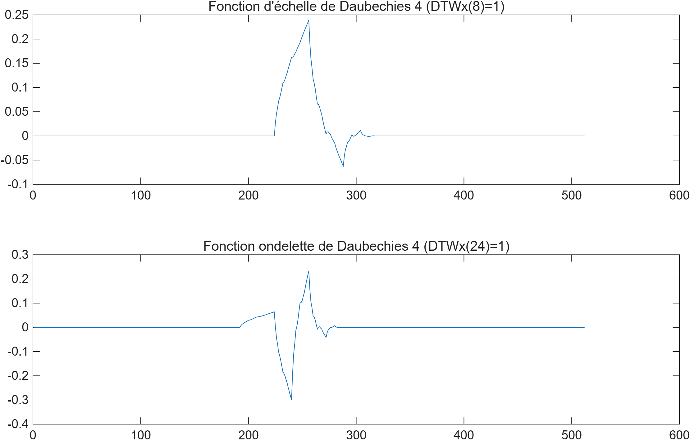
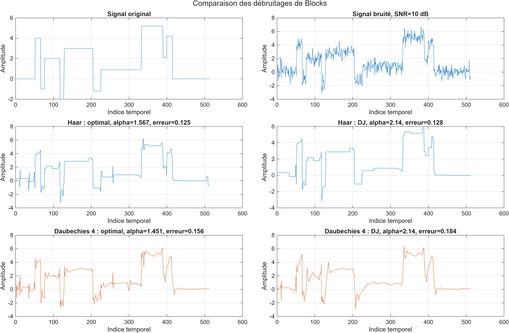
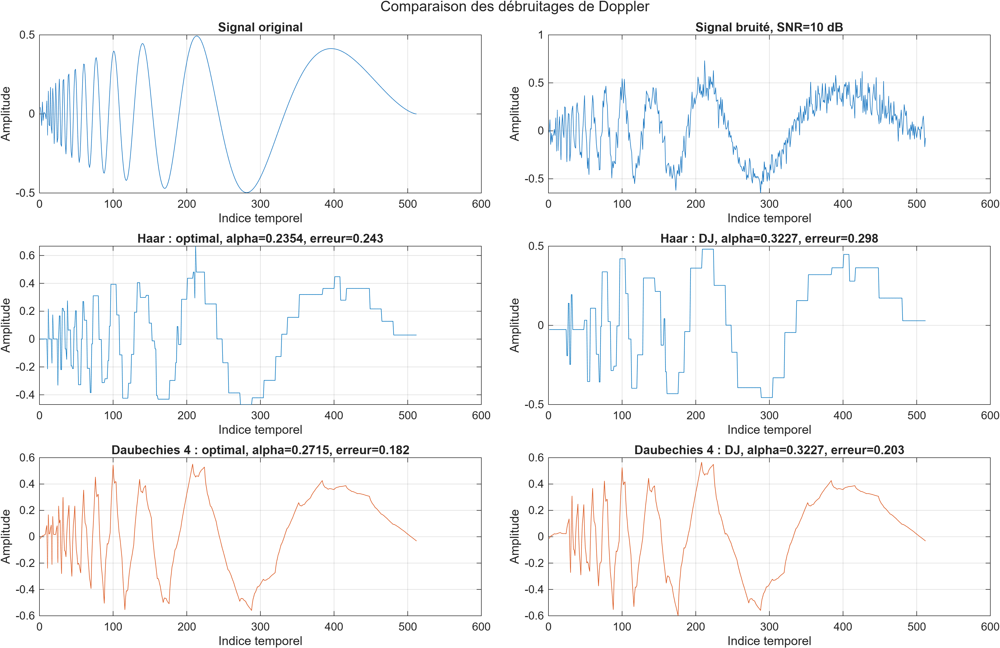
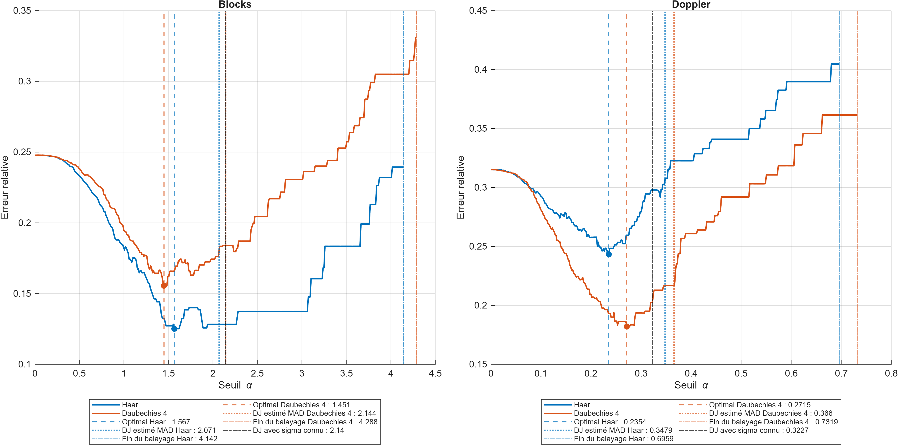
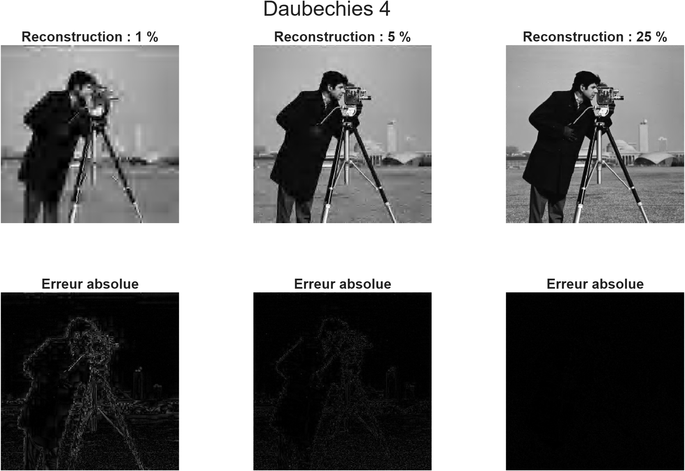
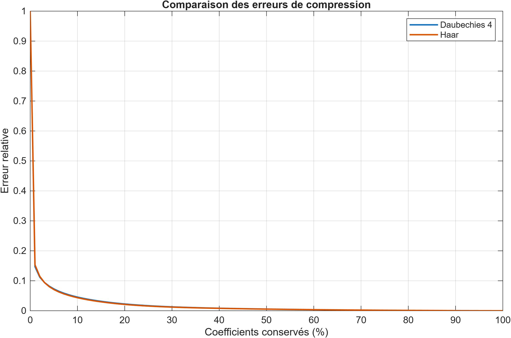

# Introduction to the Discrete Wavelet Transform

An introduction to the Discrete Wavelet Transform (DWT) with MATLAB, covering scaling functions and wavelets, one-dimensional signal denoising, and image compression through coefficient selection.

**Author: Florian Barbe**

[Read the report — in French](compte_rendu_DWT_etat_actuel.pdf)

## Contents

- `scripts/TPHaar.m`: construction of Haar and Daubechies 4 scaling functions and wavelets, followed by denoising of the Blocks and Doppler signals.
- `scripts/TPimage.m`: compression of `cameraman.tif` using both filters and comparison of the reconstructed images.
- `scripts/ajoute_bruit.m`: addition of Gaussian white noise.
- `figures/`: PNG figures used in the report and this README.

Expected directory structure:

```text
TP_DWT/
├── README.md
├── scripts/
│   ├── TPHaar.m
│   ├── TPimage.m
│   ├── ajoute_bruit.m
│   ├── blocks.mat
│   ├── Doppler.mat
│   ├── cameraman.tif
│   └── WaveLab802_datasim2026/
├── figures/
└── compte_rendu_DWT_etat_actuel.pdf
```

## Running the scripts

Requirements: MATLAB, Image Processing Toolbox for `im2double`, and the `WaveLab802_datasim2026` distribution. The supplied figures were generated with MATLAB R2025b.

Place the complete WaveLab directory inside `scripts/`, as shown above. The functions `DWT_datasim`, `DWTinv_datasim`, `DWT2_datasim`, `DWT2inv_datasim`, `plot_dwt`, and `im_dwt2` are custom additions to WaveLab; the standard distribution alone may not include them.

In MATLAB, from the `TP_DWT` directory, run:

```matlab
run(fullfile('scripts','TPHaar.m'));
```

After inspecting the figures, run the image compression script:

```matlab
run(fullfile('scripts','TPimage.m'));
```

The scripts display figures without automatically exporting files. Each script starts with `close all`, so running the second script closes the figures from the first.

## Scaling functions and wavelets

Applying the inverse DWT to a vector containing a single nonzero coefficient reconstructs a basis function. An approximation coefficient produces a scaling function, while a detail coefficient produces a wavelet.



## Denoising Blocks and Doppler

For each signal, the same noise realization is used with both filters at an SNR of 10 dB. Small coefficients are removed by hard thresholding, and the signal is reconstructed using the inverse DWT.

The Donoho–Johnstone universal threshold is `sigma_b * sqrt(2*log(N))`. Estimating `sigma_b` from the finest-scale detail coefficients using the median absolute deviation (MAD) also provides a statistical threshold based solely on the noisy signal.

The threshold search uses a grid ranging from zero to twice the MAD-based threshold. This upper limit is a practical choice rather than a theoretical guarantee. The “optimal” threshold minimizes the reconstruction error over the tested grid; selecting it requires the clean reference signal available in the simulation.

| Signal | Wavelet | Error at the optimal threshold | Error at the DJ threshold |
|---|---|---:|---:|
| Blocks | Haar | 12.52% | 12.83% |
| Blocks | Daubechies 4 | 15.56% | 18.40% |
| Doppler | Haar | 24.34% | 29.79% |
| Doppler | Daubechies 4 | 18.20% | 20.26% |

These results correspond to the noise realizations illustrated below. Haar is better suited to the piecewise-constant structure of Blocks, while Daubechies 4 better represents the oscillations of Doppler.







## Image compression

The two-dimensional DWT is computed over four decomposition levels. For each selected retention percentage, only the largest coefficients in absolute value are retained at their original positions.





Both filters produce similar errors, with neither consistently outperforming the other. The percentage of retained coefficients is not a measured file compression ratio: coefficient positions and encoding overhead are not accounted for.

## References and dependencies

- D. L. Donoho and I. M. Johnstone, *Ideal spatial adaptation by wavelet shrinkage*, Biometrika, 81(3), 425–455, 1994. [DOI](https://doi.org/10.1093/biomet/81.3.425). The universal threshold and MAD-based noise estimation are discussed on pp. 444–446.
- MathWorks, [`wnoisest`](https://www.mathworks.com/help/wavelet/ref/wnoisest.html), documentation of MAD-based noise estimation.
- WaveLab 802 and its DATASIM extensions: retain the original attribution and redistribution terms, including `Documentation/COPYING.m` and `Documentation/THANKS.m`.

WaveLab, its extensions, and third-party datasets remain attributed to their respective contributors.

---

# Version française
# Transformée discrète en ondelettes — TP ARSIG

Étude de la DWT avec MATLAB : construction de fonctions d’échelle et d’ondelettes, débruitage de signaux 1D et compression d’images par sélection des coefficients.

Travail réalisé dans le cadre de l’option DATASIM à Centrale Nantes.

**Auteur : Florian Barbe**

[Lire le compte rendu](compte_rendu_DWT_etat_actuel.pdf)

## Contenu

- `scripts/TPHaar.m` : fonctions d’échelle et ondelettes de Haar et Daubechies 4, puis débruitage de Blocks et Doppler.
- `scripts/TPimage.m` : compression de `cameraman.tif` avec les deux filtres et comparaison des reconstructions.
- `scripts/ajoute_bruit.m` : ajout de bruit blanc gaussien.
- `figures/` : figures PNG utilisées dans le rapport et dans cette page.

Organisation attendue pour l’exécution :

```text
TP_DWT/
├── README.md
├── scripts/
│   ├── TPHaar.m
│   ├── TPimage.m
│   ├── ajoute_bruit.m
│   ├── blocks.mat
│   ├── Doppler.mat
│   ├── cameraman.tif
│   └── WaveLab802_datasim2026/
├── figures/
└── compte_rendu_DWT_etat_actuel.pdf
```

## Exécution

Prérequis : MATLAB, Image Processing Toolbox pour `im2double`, et la version pédagogique `WaveLab802_datasim2026`. Les exports fournis ont été produits avec MATLAB R2025b.

Placer le dossier WaveLab complet dans `scripts/`, comme dans l’arborescence ci-dessus. Les fonctions `DWT_datasim`, `DWTinv_datasim`, `DWT2_datasim`, `DWT2inv_datasim`, `plot_dwt` et `im_dwt2` sont des ajouts pédagogiques à WaveLab : une distribution standard seule ne suffit pas nécessairement.

Dans MATLAB, depuis le dossier `TP_DWT`, lancer le premier script :

```matlab
run(fullfile('scripts','TPHaar.m'));
```

Puis, après avoir consulté les figures, lancer le second :

```matlab
run(fullfile('scripts','TPimage.m'));
```

Les scripts affichent les figures sans exporter de fichiers automatiquement. Chaque script commence par `close all` : lancer le second ferme donc les fenêtres du premier.

## Fonctions d’échelle et ondelettes

La DWT inverse d’un vecteur contenant un seul coefficient non nul permet de reconstruire une fonction de la base. Un coefficient d’approximation produit une fonction d’échelle ; un coefficient de détail produit une ondelette.


## Débruitage de Blocks et Doppler

Pour chaque signal, la même réalisation du bruit est utilisée avec les deux filtres, à un SNR de 10 dB. Les coefficients faibles sont supprimés par seuillage dur, puis le signal est reconstruit par DWT inverse.

Le seuil universel de Donoho–Johnstone est `sigma_b * sqrt(2*log(N))`. Une estimation de `sigma_b` par MAD sur les détails fins permet aussi de calculer un seuil statistique à partir du seul signal bruité.

La recherche du meilleur seuil parcourt une grille allant de zéro à deux fois le seuil estimé par MAD. Cette limite est un choix pratique, pas une garantie théorique. Le seuil « optimal » désigne le minimum sur la grille testée ; sa sélection utilise le signal propre connu en simulation.

| Signal | Ondelette | Erreur au seuil optimal | Erreur au seuil DJ |
|---|---|---:|---:|
| Blocks | Haar | 12,52 % | 12,83 % |
| Blocks | Daubechies 4 | 15,56 % | 18,40 % |
| Doppler | Haar | 24,34 % | 29,79 % |
| Doppler | Daubechies 4 | 18,20 % | 20,26 % |

Ces valeurs correspondent aux réalisations illustrées ci-dessous. Haar convient mieux aux plateaux de Blocks ; Daubechies 4 représente mieux les oscillations de Doppler.


## Compression d’images

La DWT 2D est calculée sur quatre niveaux. Pour chaque pourcentage choisi, seuls les plus grands coefficients en valeur absolue sont conservés, à leur position d’origine.


Les deux filtres donnent des erreurs proches, sans avantage systématique pour l’un d’eux. Le pourcentage de coefficients conservés n’est pas un rapport de taille de fichier mesuré : le stockage des positions et le codage ne sont pas pris en compte.

## Références et dépendances

- D. L. Donoho et I. M. Johnstone, *Ideal spatial adaptation by wavelet shrinkage*, Biometrika, 81(3), 425–455, 1994. [DOI](https://doi.org/10.1093/biomet/81.3.425). Le seuil universel et l’estimation du bruit par MAD sont discutés p. 444–446.
- MathWorks, [`wnoisest`](https://www.mathworks.com/help/wavelet/ref/wnoisest.html), documentation de l’estimation du bruit par MAD.
- WaveLab 802 et ajouts pédagogiques DATASIM : conserver les mentions d’origine et les conditions de redistribution de la bibliothèque, notamment `Documentation/COPYING.m` et `Documentation/THANKS.m`.

Le sujet de TP, la bibliothèque, ses adaptations et les données tierces ne doivent pas être présentés comme des créations originales des auteurs du compte rendu.
